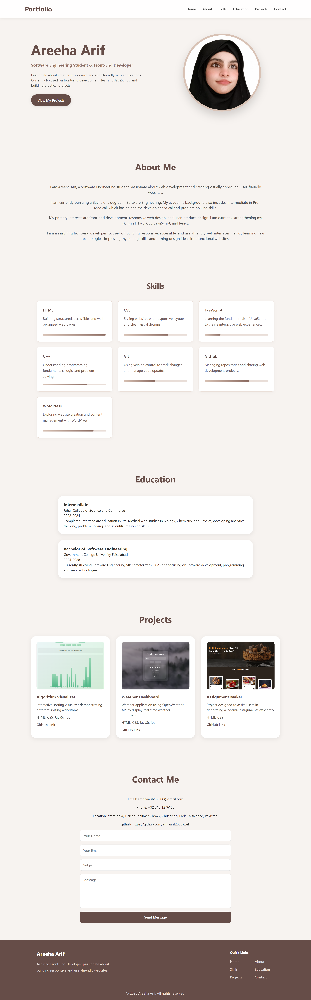

# Personal Portfolio Website

## Project Title
Responsive Personal Portfolio Website

## Project Description
This project is a personal portfolio website developed as part of
Devixo Solutions Internship Task 01.

The website introduces my academic background, technical skills,
career interests, and projects in a clean and responsive layout.

## Technologies Used
- HTML5
- CSS3

## Website Features
- Responsive navigation bar
- Home section with personal introduction
- About section
- Technical skills cards
- Education section
- Projects section
- Contact section
- Social links
- Footer with quick navigation
- Responsive layout for different screen sizes
- Hover effects and smooth navigation

## Project Structure
## 📁 Project Structure

```text
devixo-portfolio-task/
│
├── portfolio/
│   ├── images/
│   │   ├── profile.png
│   │   ├── project1.png
│   │   ├── project2.png
│   │   └── project3.png
│   │
│   ├── index.html
│   └── style.css
│
├── report/
│   └── Project-Documentation.pdf
│
├── screenshots/
│   ├── about.png
│   ├── contact.png
│   ├── css.png
│   ├── education.png
│   ├── footer.png
│   ├── home.png
│   ├── html.png
│   ├── laptop.png
│   ├── mobile.png
│   ├── projects.png
│   ├── skills.png
│   └── tablet.png
│
└── README.md
```

## Screenshots


## How to Run the Project
1. Download or clone this repository.
2. Open the project folder.
3. Open index.html in a web browser.

## Developer
Areeha Arif

## GitHub Profile
https://github.com/arihaarif2006-web
